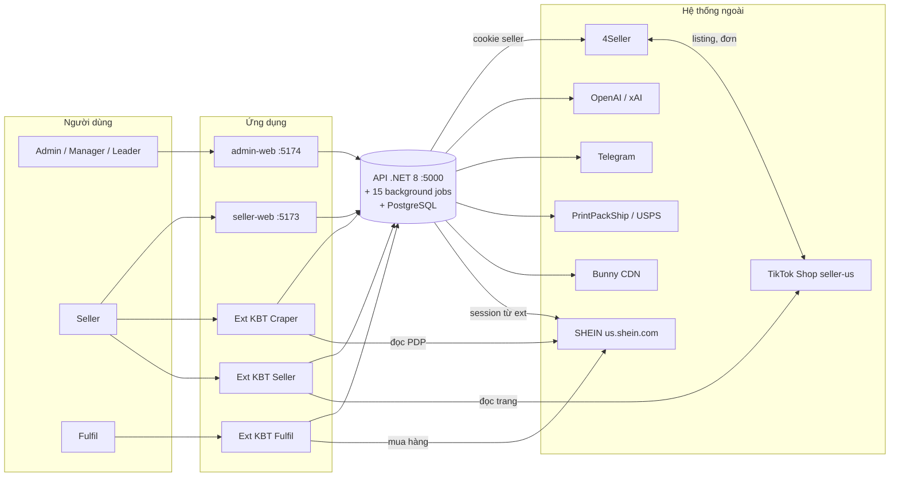
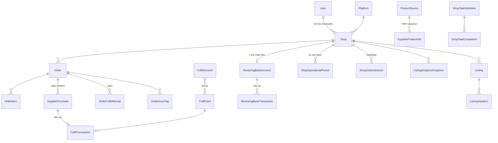
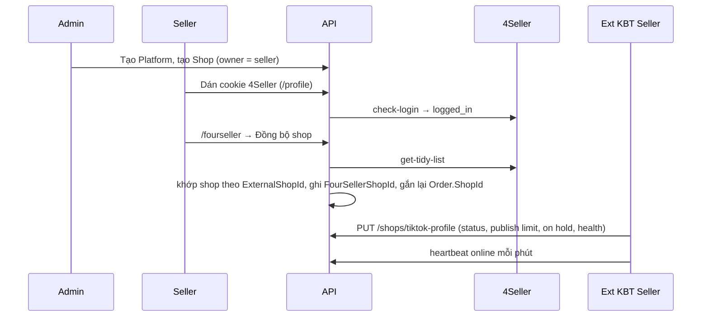
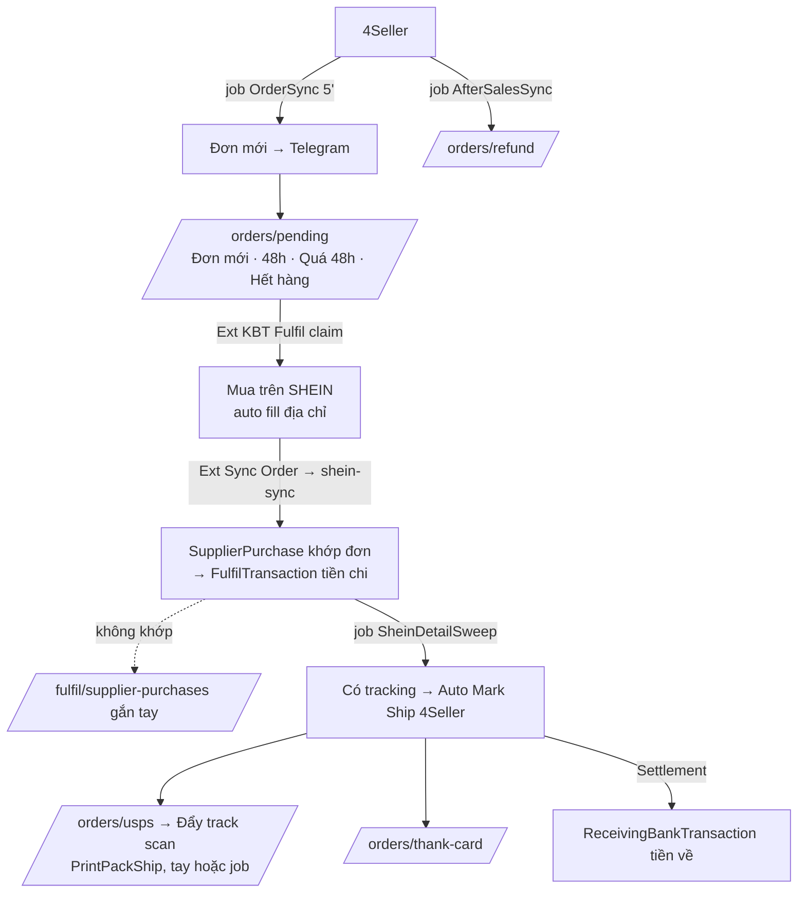

# Bản đồ hệ thống — drop.kbtglobal.app

Tài liệu "nhìn từ trên xuống": hệ thống gồm những gì, ai dùng, dữ liệu chảy ra sao, mỗi trang để làm gì. Chi tiết kỹ thuật xem [architecture.md](architecture.md), hợp đồng API xem [api.md](api.md).

Nghiệp vụ một câu: **nền tảng vận hành dropshipping cho seller TikTok Shop US** — hàng lấy từ SHEIN, listing và đơn đi qua 4Seller, công ty quản lý shop, seller, tiền ra (thẻ mua hàng) và tiền về (thẻ nhận tiền).

---

## 1. Toàn cảnh



Nguyên tắc xuyên suốt:
- **4Seller là nguồn sự thật** cho đơn hàng và listing. DB local chỉ là bản mirror.
- **Backend giữ cookie 4Seller của từng seller**, extension và web không bao giờ nhận cookie thô.
- **Seller chỉ thấy dữ liệu của mình** (`OwnerId` = user trong JWT). Admin thấy tất cả.

---

## 2. Người dùng và công cụ

| Vai trò | Dùng gì | Làm gì |
|---|---|---|
| **Admin** | admin-web | Toàn quyền: shop, user, role, settings, tài chính, đơn, listing. |
| **Manager / Leader** | admin-web | Quyền do admin gán theo permission `admin.*`. |
| **Seller** | seller-web + ext KBT Craper + ext KBT Seller | Dán cookie 4Seller, kết nối shop, đẩy sản phẩm lên draft, chỉnh listing, theo dõi đơn và tiền về. |
| **Fulfil** | ext KBT Fulfil (login bằng PIN 4 số) | Nhận đơn cần mua, mua trên SHEIN, đồng bộ billno về hệ thống. |

Ba extension (Chrome MV3, thư mục `frontend/*-extension`):
- **KBT Craper** (`browser-extension`): trên trang sản phẩm SHEIN/Temu, chọn shop rồi bấm đẩy → tạo draft trên 4Seller.
- **KBT Seller** (`tiktok-shop-extension`): mở seller-us.tiktok.com, đồng bộ hồ sơ shop, payout, keyword, analytics, health; gửi heartbeat "shop đang online"; thực hiện nhiệm vụ ngày (ghé URL).
- **KBT Fulfil** (`fulfil-extension`): hàng đợi đơn cần mua, claim đơn, auto điền địa chỉ ở checkout SHEIN, sync đơn SHEIN về.

---

## 3. Dữ liệu cốt lõi



Khoá cần nhớ:
- `Shop.ExternalShopId` (= TikTok seller id) là **khoá bền**. `Shop.FourSellerShopId` là id tạm, đổi mỗi lần kết nối lại 4Seller.
- `Listing.FourSellerListingId` là id nội bộ của *một* tài khoản 4Seller; shop đổi tài khoản thì id đổi, hệ thống nhận lại theo `(ShopId, TikTokProductId)`.
- `Order` unique theo `FourSellerOrderId` và `(OwnerId, PlatformOrderId)`.
- `SupplierPurchase.SupplierOrderNo` (billno SHEIN) unique toàn DB.
- `Settings` (key-value theo nhóm) điều khiển gần như mọi job nền: bật/tắt, interval, lookback, chat Telegram.

---

## 4. Các luồng nghiệp vụ

### 4a. Onboarding shop và kết nối 4Seller



1. Admin tạo Platform tại `/platforms`, tạo Shop tại `/shops` (chọn seller sở hữu).
2. Seller dán cookie 4Seller ở `/profile`. Job `FourSellerCookieRecheck` (15 phút) tự chuyển `expired → logged_in` khi cookie sống lại.
3. Seller (hoặc admin) bấm **Đồng bộ shop** ở `/fourseller`. Hệ thống đọc danh sách shop từ 4Seller, khớp theo `ExternalShopId`, ghi id 4Seller mới, gắn lại đơn mồ côi.
4. Ext KBT Seller cập nhật trạng thái thật của shop từ TikTok (Active/Suspended, publish limit, DELI, on hold). Đổi trạng thái → Telegram + mở/đóng kỳ vận hành.
5. Heartbeat online tạo `ShopOnlineSessions` → cột **Online** trong danh sách shop.
6. **Chuyển shop sang seller khác** phải theo thứ tự: đổi `OwnerId` (cascade đơn, listing, analytics) → Đồng bộ shop 4Seller → Đồng bộ ownership. Kiểm tra `GET /admin/shops/mapping-health` nếu còn đơn thiếu shop.

### 4b. Listing: từ sản phẩm SHEIN đến lên kệ TikTok

```mermaid
flowchart LR
  PDP[Trang SP SHEIN/Temu] -->|Ext KBT Craper| DR[Draft trên 4Seller]
  DR -->|job ListingDraftSync 15'| ML[Mirror local /listings/draft]
  ML -->|/listings/:id/edit| ED[Chỉnh: category AI, Rewrite OpenAI,<br/>Specifics, ảnh, Size Chart xAI, giá/ship]
  ED -->|Publish tay hoặc<br/>job ListingAutoPublish| PB[Published trên 4Seller/TikTok]
  PB -->|job ListingPublishedSync 60'| MP[Mirror /listings/published]
  TTS[TikTok Compass] -->|Ext KBT Seller| AN[/listings/analytics]
  AN -->|điểm delist| DL[Đề xuất hủy list → Deactivate]
```

1. **Đẩy sản phẩm**: Craper nhận diện trang theo `ProductSource.Domains`, chọn ≥1 shop, gọi `POST /fourseller/crawl/post-html`. Backend nén HTML và gọi 4Seller bằng cookie của seller. Admin có đường thay thế `/product-scrape`.
2. **Mirror draft**: job `ListingDraftSync` (15 phút) hoặc nút Đồng bộ (`POST …/listings/sync`, chạy nền trả jobId). `RawPayload` chỉ ghi lần đầu.
3. **Chỉnh listing** (`/listings/:id/edit`): gợi ý category (OpenAI), **Rewrite** mô tả + title + search terms + highlights (OpenAI, mặc định chỉ 1 lần), Auto Specifics theo schema category (có denylist tự học từ lỗi TikTok), chèn ảnh, sinh **Size Chart** (xAI), áp template giá và vận chuyển.
4. **Cổng publish**: chưa Rewrite, thiếu Size Chart, ảnh lỗi → chặn. Payload được làm sạch (http→https, bỏ GIF/video) trước khi đẩy 4Seller.
5. **Auto publish**: job `ListingAutoPublish` publish draft đủ điều kiện cho shop còn slot (`PublishLimitPublished < Total`), theo interval từng shop.
6. **Mirror published**: job `ListingPublishedSync` (60 phút, chỉ trạng thái). Trang `/listings/published` cho Deactivate/Xóa hàng loạt.
7. **Analytics**: Ext KBT Seller đọc TikTok Compass 7 ngày → `ListingAnalyticsSnapshots` (1 dòng/sản phẩm/ngày, lấy MAX chứ không cộng dồn).
8. **Delist**: điểm 0–100 (≥70 nên hủy, ≥50 xem xét; giữ nếu đơn hoặc GMV còn tốt) → nút Hủy list.

### 4c. Đơn hàng: từ 4Seller đến giao hàng và hoàn tiền



1. **Sync đơn**: `OrderSync` (mới, mặc định 5 phút, lookback 2 ngày) và `OrderStatusSync` (trạng thái, lookback dài) kéo từ 4Seller cho mọi seller có cookie sống. Mỗi lần lưu, hook tính lại cột denorm (`WorkflowTab`, signals, `IsCharged`). Đơn mới → Telegram.
2. **Chờ mua** (`/orders/pending`): đơn `AWAITING_SHIPMENT` chưa có `FulfilPurchasedAt`.
3. **Fulfil**: ext KBT Fulfil login PIN → tab Đơn cần mua → claim (`POST …/fulfil-claim`, lease theo user, realtime qua SignalR `/hubs/notifications`) → mở PDP SHEIN, auto chọn size/màu, auto điền địa chỉ → bấm «Đã mua».
4. **Ghi nhận mua**: ext Sync Order đọc danh sách đơn SHEIN → `POST …/shein-sync`. Backend upsert mọi billno, khớp đơn theo phone + zip + tên (+ ràng buộc thời gian 12h), đánh `IsCharged`, ghi 1 dòng `FulfilTransaction`. Không khớp → `/fulfil/supplier-purchases` gắn tay.
5. **Tracking và Mark Ship**: job `SheinDetailSweep` dùng session SHEIN do extension đẩy lên, lấy chi tiết đơn thiếu tracking, rồi Auto Mark Ship lên 4Seller (3 bước, có trạng thái `unconfirmed`).
6. **USPS**: `/orders/usps` liệt kê đơn có tín hiệu USPS chưa xử lý → đẩy track scan qua PrintPackShip (tay, hoặc job `UspsScanAutoPush` trong khung giờ ET T2–T7).
7. **Thank card**: badge TKS khi có track kho SHEIN → đánh dấu đã xử lý + số tiền.
8. **Sau bán / Refund**: job `AfterSalesSync` là nơi **duy nhất** đặt/gỡ trạng thái `REFUND`. Trang `/orders/refund`.
9. **Issue tag** trên đơn → Telegram. **Settlement** → tạo `ReceivingBankTransaction` loại SettlementPaid.
10. Job `OrderDailySummary` gửi Telegram tổng kết ngày / theo seller / fulfil + đơn chưa có tracking quá lâu.

### 4d. Tài chính

| Dòng tiền | Nguồn dữ liệu | Trang |
|---|---|---|
| **Tiền chi** (mua hàng) | `FulfilTransactions`: tự động từ SHEIN sync (CostUpdate) hoặc nạp/trừ tay | `/fulfil/transactions` (KPI cost, track, thank, coupon, wallet, profit), `/stats/card-spending` (theo thẻ / tài khoản / shop / người mua) |
| Thẻ và tài khoản mua hàng | `FulfilAccounts` (session SHEIN) ↔ `FulfilCards` (thẻ ảo, import Excel PingPong) | `/fulfil/accounts`, `/fulfil/cards` |
| **Tiền về** | `ReceivingBankTransactions`: SettlementPaid (từ đơn), TikTokPayout (ext KBT Seller, tự Confirmed khi 4 số cuối khớp thẻ), Manual (seller tạo Pending, admin duyệt) | `/receiving-banks` (catalog thẻ), `/receiving-banks/transactions`, `/stats/receiving-banks` |
| Tài chính shop | Tiền đã về + on hold / chờ giao / reserve (snapshot TikTok) + giá mua shop | `/shops/finance` |
| Sổ cái công ty | `CompanyLedgerEntries` (mua shop, proxy, OpenAI, Cursor…), USD/VND tách, không vào KPI | `/system/ledger` (admin), `/ledger` (seller đọc) |
| Dashboard | KPI đơn/doanh thu chỉ shop Active có gắn thẻ, loại CANCELLED/REFUND; lợi nhuận = doanh thu − FulfilTransactions | `/dashboard`, `/stats/*` |

### 4e. Khuyến mãi

Job `ProductDiscountSync` (poll 60 giây, mỗi lane 2 giờ) kéo chương trình **ONGOING** từ 4Seller: Product Discount và Flash Deal → `ProductDiscountActivities`, dọn bản ghi không còn chạy. Trang `/promotions/product-discount`, `/promotions/flash-deal`; Deactivate xoá dòng.

### 4f. Nhiệm vụ ngày của shop

Admin định nghĩa `ShopTaskDefinitions` (URL TikTok cần ghé, thời gian xem) tại `/shop-tasks/settings`. Board `/shop-tasks/daily` (landing mặc định của cả hai portal) gom 4 loại:
- `sync_extension`: xong khi ext KBT Seller đã sync đủ profile / payout / keyword / analytics trong ngày.
- `url_visit`: ext ghé URL, backend kiểm lại URL theo pattern.
- `listing_fill`: chỉ hiển thị khi shop còn slot publish.
- `delist_cleanup`: chip "Cần hủy N · Xem xét M" từ điểm delist, dẫn sang analytics.

### 4g. Cấu hình, người dùng, phân quyền

- `/settings`: key-value theo nhóm (Bunny, các job sync, auto publish, rewrite, Telegram, USPS, data retention…). Đổi ở đây là đổi hành vi job, không cần deploy.
- `/users`: CRUD, import Excel, dán cookie 4Seller hộ seller + check login, đặt PIN fulfil. Xoá cứng bị chặn khi còn dữ liệu.
- `/roles`: role hệ thống (Admin/Manager/Leader/Seller/Fulfil) không xoá được; permission chỉ seed từ code; đổi quyền phải đăng nhập lại.
- JWT mang claims `permission` + `ss` (security stamp); đổi mật khẩu hoặc khoá user → mọi refresh token bị thu hồi.

---

## 5. Job nền (tất cả kế thừa `ResilientBackgroundService`, exception không được giết host)

| Job | Việc | Nhịp |
|---|---|---|
| OrderSync | Đơn mới từ 4Seller | tick 1', interval Settings (5') |
| OrderStatusSync | Trạng thái đơn, lookback dài | tick 1' |
| AfterSalesSync | Returns TikTok → REFUND | tick 1' (mặc định tắt) |
| SheinSync | SHEIN realtime server-side (legacy) | 30s |
| SheinDetailSweep | Chi tiết đơn SHEIN thiếu tracking, Auto Mark Ship | 60s, nghỉ 10' sau chu kỳ (mặc định tắt) |
| ListingDraftSync | Mirror draft | 15' |
| ListingPublishedSync | Mirror trạng thái published | 60' |
| ListingAutoPublish | Publish draft đủ điều kiện | per-shop (Settings) |
| ProductDiscountSync | Product Discount + Flash Deal | poll 60s, lane 2h |
| OrderDailySummary | Telegram tổng kết | poll 1' |
| OrderWorkflowSignalsVerify | Kiểm tra và sửa cột denorm 5000 đơn mới | 1h |
| FourSellerCookieRecheck | expired → logged_in | 15' |
| UspsScanAutoPush | Đẩy track scan USPS | theo khung giờ ET |
| DataRetention | Dọn snapshot >90d, sync log >30d, token revoked >7d | 24h |
| SyncWatchdog | Cảnh báo Telegram khi sync đơn trễ/chết | 5' |

Production còn Task Scheduler `DropKinhbac-KeepApiAlive` ping `/health` mỗi phút để IIS không ngủ (xem `scripts/`).

---

## 6. Bản đồ trang

Sidebar hiện tại chỉ hiện một phần, các route khác vẫn vào được bằng URL. Nhãn menu lấy từ `@drop/ui/navLabels`.

### admin-web (http://localhost:5174)

| Nhóm | Route | Mục đích |
|---|---|---|
| Landing | `/` → `/shop-tasks/daily` | Board nhiệm vụ ngày |
| Listings | `/listings/draft`, `/listings/published`, `/listings/analytics`, `/listings/:id/edit` | Mirror draft/published, analytics + delist, form chỉnh và đẩy listing |
| | `/product-opportunities` | Keyword trending TikTok (bookmark, copy câu tìm SHEIN) |
| Nhiệm vụ ngày | `/shop-tasks/daily`, `/shop-tasks/optimize`, `/shop-tasks/settings` | Board, tối ưu (delist), định nghĩa URL task |
| Quản lý shop | `/shops`, `/shops/finance`, `/fourseller`, `/platforms` | CRUD shop, tài chính shop, kết nối 4Seller, nền tảng |
| Đơn hàng | `/orders`, `/orders/pending`, `/orders/thank-card`, `/orders/refund`, `/orders/usps` | Card đơn + lọc nhanh, drawer chi tiết, mark ship, note |
| Fulfil | `/fulfil/accounts`, `/fulfil/cards`, `/fulfil/transactions`, `/fulfil/supplier-purchases` | Tài khoản mua, thẻ, sổ chi tiêu, billno chưa khớp |
| Tiền về | `/receiving-banks`, `/receiving-banks/transactions` | Catalog thẻ nhận tiền, lịch sử tiền về + duyệt |
| Thống kê | `/dashboard`, `/stats/orders`, `/stats/revenue`, `/stats/seller-performance`, `/stats/charts`, `/stats/card-spending`, `/stats/receiving-banks` | KPI, trend, heatmap, hiệu suất seller, chi tiêu thẻ, tiền về |
| Khuyến mãi | `/promotions/product-discount`, `/promotions/flash-deal` | Chương trình đang chạy |
| Nguồn hàng | `/product-sources`, `/product-scrape`, `/supplier-lists`, `/supplier-lists/:id` | Domain nguồn hàng, scrape 4Seller, shop NCC + KPI |
| Danh mục | `/categories` | Category TikTok (sync từ 4Seller) |
| Hệ thống | `/users`, `/roles`, `/settings`, `/system/ledger` | Người dùng, RBAC, cấu hình, sổ cái công ty |

### seller-web (http://localhost:5173)

Giống admin-web nhưng tự động giới hạn theo seller đang đăng nhập, không có trang quản trị. Khác biệt chính:

| Route | Mục đích |
|---|---|
| `/profile` | Dán cookie 4Seller, check login |
| `/files` | Thư viện file trên Bunny CDN |
| `/ledger` | Sổ cái công ty, chỉ đọc |
| `/receiving-banks/transactions` | Tạo giao dịch tiền về thủ công (Pending, chờ admin duyệt) |
| `/fulfil/transactions` | Chi tiêu của chính seller |
| `/orders/*`, `/listings/*`, `/stats/*`, `/shops`, `/shops/finance`, `/promotions/*`, `/shop-tasks/*`, `/product-opportunities`, `/supplier-lists*`, `/fourseller` | Như admin, scope theo owner |

---

## 7. Điều bất biến phải nhớ khi sửa code

- **Timezone**: DB và API lưu UTC. UI, Telegram, dashboard dùng `Asia/Ho_Chi_Minh`. Chuỗi thời gian 4Seller trả về đã là UTC. Unix time SHEIN là UTC. Lọc theo ngày tạo đơn 4Seller là ngày Pacific. Khung giờ USPS theo ET.
- **Job nền không được giết host**: mọi job qua `ResilientBackgroundService`; sự cố 2026-09-30 một timeout Npgsql đã hạ API 2,5 giờ.
- **DB phình vì blob TOAST** (`Listings.RawPayload`, `DescriptionHtml`, `SupplierPurchases.RawPayload`), không phải index. Tránh UPDATE blob khi nội dung không đổi.
- `RawPayload` listing và `SupplierDescriptionHtml` **ghi một lần**.
- Chỉ luồng after-sales được đặt/gỡ `REFUND`. `CANCELLED` thắng. `COMPLETED` là alias của `DELIVERED`.
- Cột denorm của đơn chỉ được tính qua `OrderWorkflowSignals.Apply` và `OrderSupplierCost.ApplyAggregates` trong hook `SaveChangesAsync`.
- Analytics snapshot lấy **MAX giữa các ngày, không SUM** (cửa sổ 7 ngày trượt).
- Cookie 4Seller không bao giờ trả về client. Extension chỉ gọi API này.
- `OwnerId`, `SnapshotDate` do server quyết định, không tin client.
- Frontend: types ở `@drop/types`, gọi API ở `@drop/api-client`, UI theo feature ở `@drop/<feature>`; app shell chỉ lo route, menu, gate permission.

---

## 8. Chạy local

Xem [README.md](../README.md). Tóm tắt: API `dotnet run --launch-profile http` (migration + seed tự chạy), `npm run dev:seller` / `npm run dev:admin`. Tài khoản seed `admin / Admin@123`, `seller / Seller@123`.
