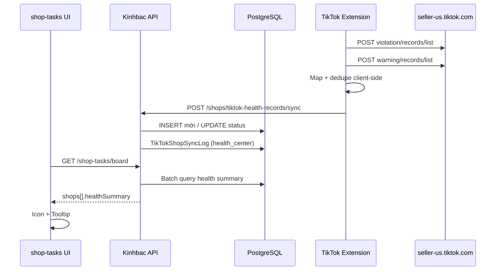

# Plan: TikTok Shop Violation & Warning trên Shop Tasks

> **Trạng thái:** Draft — chờ triển khai  
> **Ngày tạo:** 2026-08-24  
> **Phạm vi:** Extension sync → Backend DB → Icon hiển thị trên `@drop/shop-tasks`

---

## 1. Mục tiêu

| Mục tiêu | Mô tả |
|----------|--------|
| **Hiển thị** | Icon violation (đỏ) và warning (vàng) trên bảng Shop Tasks |
| **Nguồn dữ liệu** | TikTok Seller Center — Growth Center API |
| **Đồng bộ** | Extension scrape → POST lên Kinhbac API |
| **Lưu trữ** | Bảng riêng, dedup theo `record_id` (không insert trùng) |
| **Payload nhẹ** | Chỉ lưu các trường cần thiết cho UI |

---

## 2. API TikTok (Extension scrape)

### 2.1 Violation records

```
POST /api/v1/seller/growth_center/shop/violation/records/list
Body: { "limit": 20, "offset": 0, "view_source": 0 }
```

### 2.2 Warning records

```
POST /api/v1/seller/growth_center/shop/warning/records/list
Body: { "limit": 20, "offset": 0, "view_source": 0 }
```

### 2.3 Trường lấy từ JSON (map sang DB)

| Trường JSON | Trường DB | Ghi chú |
|-------------|-----------|---------|
| `record_id` | `RecordId` | **Khóa dedup** — tương đương `id` của message TikTok |
| `static_expression.reason` | `Reason` | Tiêu đề ngắn |
| `static_expression.detail` | `Detail` | Mô tả — strip HTML trước khi lưu |
| `static_expression.type` | `CategoryType` | Loại vi phạm, vd: "Policy Compliance" |
| `static_expression.enforcement_expression.action_informations[].action_title` | `ActionTitles` | JSON array — hình thức phạt |
| `state.record_status` | `RecordStatus` | `1` = active (dùng để đếm icon) |
| `create_time` | `CreateTime` | Unix seconds → UTC |

**Không lưu:** `suggestion`, `policy`, HTML links, toàn bộ `strategy_information`.

---

## 3. Luồng dữ liệu



### Nguyên tắc thiết kế

- Extension scrape qua **content script** + cookie session (giống payout/analytics).
- Backend resolve shop: `OwnerId + ExternalShopId` — **không tự tạo shop**.
- Dedup theo `(ShopId, RecordId)` — pattern giống payout `PaymentId`, opportunity `LeadId`.
- **Không** thêm vào `RequiredSyncTypes` (vẫn 4 bước cho nhiệm vụ `sync_extension`).
- Thêm **bước 5** trong Unified Sync: `health_center` (chạy sau analytics).

---

## 4. Phase 1 — Database

### 4.1 Bảng `TikTokShopHealthRecords`

| Cột | Kiểu | Mô tả |
|-----|------|-------|
| `Id` | `uuid` | PK |
| `ShopId` | `uuid` | FK → `Shops` |
| `RecordId` | `varchar(32)` | TikTok record id |
| `RecordType` | `varchar(16)` | `violation` \| `warning` |
| `Reason` | `varchar(500)` | |
| `Detail` | `varchar(2000)` | Plain text |
| `CategoryType` | `varchar(128)` | |
| `ActionTitles` | `jsonb` | `["Settlement period is extended", ...]` |
| `RecordStatus` | `smallint` | `1` = active |
| `CreateTime` | `timestamptz` | Thời điểm TikTok tạo record |
| `FirstSyncedAt` | `timestamptz` | Lần ghi đầu |
| `LastSyncedAt` | `timestamptz` | Lần sync gần nhất |

### 4.2 Index & constraint

```sql
UNIQUE (ShopId, RecordId)
INDEX  (ShopId, RecordType, RecordStatus)
INDEX  (ShopId, CreateTime DESC)
```

### 4.3 Dedup logic

| Trường hợp | Hành vi |
|------------|---------|
| `RecordId` chưa có | `INSERT` |
| `RecordId` đã có | `UPDATE` status, actionTitles, LastSyncedAt |
| Payload trùng trong 1 request | Dedupe client + server Dictionary |

### 4.4 Migration

```
backend/src/Infrastructure/Persistence/Migrations/
  20260824140000_AddTikTokShopHealthRecords.cs
```

---

## 5. Phase 2 — Backend

### 5.1 Files tạo mới

```
backend/src/Domain/Entities/TikTokShopHealthRecord.cs
backend/src/Infrastructure/Persistence/Configurations/TikTokShopHealthRecordConfiguration.cs
backend/src/Shared/Constants/TikTokShopHealthRecordTypes.cs
backend/src/Application/DTOs/Shop/TikTokShopHealthRecordDtos.cs
backend/src/Application/Interfaces/ITikTokShopHealthRecordService.cs
backend/src/Application/Services/TikTokShopHealthRecordService.cs
backend/src/Application/Validators/Shop/SyncTikTokShopHealthRecordsValidator.cs
backend/tests/Application.Tests/TikTokShopHealthRecordServiceTests.cs
```

### 5.2 Constants cập nhật

```csharp
// TikTokShopSyncTypes.cs — thêm:
public const string HealthCenter = "health_center";
```

### 5.3 DTOs

#### Sync request (extension → backend)

```json
{
  "externalShopId": "7496154235269843519",
  "runId": "uuid",
  "items": [
    {
      "recordId": "7676769392881320205",
      "recordType": "violation",
      "reason": "High Customer Complaint Rate",
      "detail": "Your products have received a large number of complaints...",
      "categoryType": "Policy Compliance",
      "actionTitles": [
        "Settlement period is extended",
        "Shop visibility reduced",
        "AHR violation points: 10 point(s)"
      ],
      "recordStatus": 1,
      "createTime": 1787387290
    }
  ]
}
```

#### Sync response

```json
{
  "shopId": "uuid",
  "inserted": 1,
  "updated": 0,
  "skipped": 0
}
```

#### Board summary (nhẹ — embed trong shop-tasks board)

```json
{
  "activeViolationCount": 1,
  "activeWarningCount": 0,
  "recent": [
    {
      "recordId": "7676769392881320205",
      "recordType": "violation",
      "reason": "High Customer Complaint Rate",
      "categoryType": "Policy Compliance",
      "actionTitles": ["Settlement period is extended"],
      "createTime": "2026-08-22T..."
    }
  ]
}
```

### 5.4 Service flow (`SyncAsync`)

```
1. Resolve externalShopId (+ SellerId alias)
2. Resolve shop: OwnerId + ExternalShopId
3. Dedupe payload theo RecordId
4. Load existing records
5. INSERT mới / UPDATE status + actions
6. Strip HTML từ Detail
7. Ghi TikTokShopSyncLog (health_center, completed|failed)
8. Trả { inserted, updated, skipped }
```

### 5.5 API endpoints

| Method | Route | Permission | Mô tả |
|--------|-------|------------|-------|
| `POST` | `/shops/tiktok-health-records/sync` | `seller.shops.edit` | Extension ingest |
| `GET` | `/shops/tiktok-health-records?shopId=` | `seller.shops.view` | Chi tiết (optional) |

Wire trong `ShopsController.cs` — cùng nhóm TikTok sync hiện có.

### 5.6 Enrich Shop Tasks board

Mở rộng `ShopTaskShopDto`:

```csharp
public ShopHealthSummaryDto? HealthSummary { get; set; }
```

Trong `ShopTaskService.GetBoardAsync`:

- Gọi `GetSummaryForShopsAsync(shopIds)` **một lần** (batch, không N+1).
- Gắn summary vào từng shop row.
- (Tùy chọn) Cộng `activeViolationCount > 0` vào `attentionCount`.

---

## 6. Phase 3 — Extension

### 6.1 Files cập nhật

```
frontend/tiktok-shop-extension/src/shared/config.ts          — API paths
frontend/tiktok-shop-extension/src/shared/messages.ts        — FETCH_HEALTH_RECORDS
frontend/tiktok-shop-extension/src/shared/types.ts           — UnifiedSyncState.healthCenter
frontend/tiktok-shop-extension/src/content/index.ts          — fetch + map
frontend/tiktok-shop-extension/src/background/index.ts       — runHealthCenterSync
frontend/tiktok-shop-extension/src/background/kinhbacApi.ts  — syncTikTokHealthRecords
frontend/tiktok-shop-extension/src/background/unifiedSyncState.ts
frontend/tiktok-shop-extension/src/popup/App.tsx             — checklist UI
```

### 6.2 TikTok API paths

```typescript
VIOLATION_RECORDS_PATH = '/api/v1/seller/growth_center/shop/violation/records/list'
WARNING_RECORDS_PATH   = '/api/v1/seller/growth_center/shop/warning/records/list'
```

- Dùng `buildSellerApiUrl` + `POST`.
- Paginate `limit=20`, tăng `offset` đến hết hoặc **cap 100 records/loại**.

### 6.3 Unified Sync — thứ tự 5 bước

```
[Profile] → [Payout] → [Keywords] → [Analytics] → [Health Center] → [Daily Tasks]
```

Label UI: **"Health Center"** hoặc **"Violation/Warning"**.

### 6.4 Map function (content script)

```typescript
function mapHealthRecord(raw, recordType: 'violation' | 'warning') {
  return {
    recordId: raw.record_id,
    recordType,
    reason: raw.static_expression?.reason ?? '',
    detail: stripHtml(raw.static_expression?.detail ?? ''),
    categoryType: raw.static_expression?.type ?? '',
    actionTitles: (raw.static_expression?.enforcement_expression?.action_informations ?? [])
      .map(a => a.action_title)
      .filter(Boolean),
    recordStatus: raw.state?.record_status ?? 0,
    createTime: raw.create_time,
  };
}
```

---

## 7. Phase 4 — Frontend Shop Tasks UI

### 7.1 Files

```
frontend/packages/types/src/shopTask.ts              — ShopHealthSummary types
frontend/packages/shop-tasks/src/ShopHealthIndicators.tsx  — component mới
frontend/packages/shop-tasks/src/ShopTasksPage.tsx     — gắn icon vào cột Shop
frontend/packages/shop-tasks/src/shopTasks.css         — styles
frontend/packages/shop-tasks/src/ShopTaskDrawer.tsx    — section chi tiết (optional)
```

### 7.2 Types mới

```typescript
export interface ShopHealthRecordBrief {
  recordId: string;
  recordType: 'violation' | 'warning';
  reason: string;
  categoryType: string;
  actionTitles: string[];
  createTime: string;
}

export interface ShopHealthSummary {
  activeViolationCount: number;
  activeWarningCount: number;
  recent: ShopHealthRecordBrief[];  // max 3 mỗi loại cho tooltip
}

// ShopTaskShop thêm:
healthSummary?: ShopHealthSummary | null;
```

### 7.3 UI spec

| Element | Chi tiết |
|---------|----------|
| Icon violation | `CloseCircleFilled`, 12px, màu error |
| Icon warning | `WarningFilled`, 12px, màu warning |
| Badge | Số count nếu > 1 |
| Tooltip | reason + categoryType + actionTitles |
| Vị trí | Cạnh tên shop, cột **Shop** |
| Ẩn | Khi cả 2 count = 0 |

Tuân thủ `ui-style.mdc`: font 12px icon, không dùng 13–14px trên list.

### 7.4 Vị trí trong bảng

```
┌─────────────────────────────────────────────────────────┐
│ Shop                                                     │
├─────────────────────────────────────────────────────────┤
│ ProfileName (ShopName)  🔴1  ⚠️2                        │
│ ID 7496154235269843519 · Owner Name                     │
└─────────────────────────────────────────────────────────┘
```

---

## 8. Phase 5 — Tài liệu

Sau khi triển khai, cập nhật:

| File | Nội dung |
|------|----------|
| `docs/api.md` | Endpoint sync + field `healthSummary` trên board |
| `docs/architecture.md` | Luồng extension → health records |

---

## 9. Thứ tự triển khai

| # | Task | Phụ thuộc | Effort |
|---|------|-----------|--------|
| 1 | Migration + Entity + EF config | — | S |
| 2 | Service sync + dedup/upsert + unit tests | 1 | M |
| 3 | `POST /shops/tiktok-health-records/sync` | 2 | S |
| 4 | Extension fetch + map + sync step | 3 | M |
| 5 | Board API enrich `healthSummary` | 2 | S |
| 6 | UI `ShopHealthIndicators` + types | 5 | M |
| 7 | Docs + manual QA | 4, 6 | S |

**Effort:** S ≈ 0.5 ngày · M ≈ 1 ngày · **Tổng ≈ 3–4 ngày**

---

## 10. Quyết định thiết kế (cần xác nhận)

| # | Câu hỏi | Đề xuất |
|---|---------|---------|
| 1 | Chạy Health Center mỗi lần Unified Sync? | **Có** — sau analytics |
| 2 | Icon chỉ hiện record active (`record_status = 1`)? | **Có** |
| 3 | Violation active tăng `attentionCount` shop? | **Có** |
| 4 | Cap pagination 100 records/loại? | **Có** — đủ cho hầu hết shop |
| 5 | Telegram notify khi violation mới? | **Phase sau** |

---

## 11. Test plan

### Backend unit

- [ ] Insert 2 records mới → `Inserted = 2`
- [ ] Sync lại cùng `record_id`, status không đổi → skip hoặc no-op update
- [ ] Sync lại, `record_status` đổi → `Updated = 1`
- [ ] Summary chỉ đếm `record_status = 1`
- [ ] Strip HTML từ Detail

### Extension manual

- [ ] Shop có violation + warning → step Health Center = completed
- [ ] Network: 2 POST TikTok + 1 POST Kinhbac
- [ ] Paginate đúng khi > 20 records

### UI manual

- [ ] Shop có violation → icon đỏ, tooltip đúng
- [ ] Shop có warning → icon vàng
- [ ] Shop sạch → không icon
- [ ] Admin + Seller portal đều thấy

### Regression

- [ ] Nhiệm vụ `sync_extension` vẫn cần đủ 4 bước cũ
- [ ] Board load vẫn 1 request, không chậm đáng kể

---

## 12. Rủi ro & giảm thiểu

| Rủi ro | Giảm thiểu |
|--------|------------|
| TikTok đổi schema API | Map defensive (`?.`), log skip invalid rows |
| HTML trong detail | Strip tags server-side |
| Sync chậm do paginate | Cap 100/loại |
| Record resolved vẫn hiện icon | Upsert `RecordStatus` mỗi lần sync |
| Shop chưa sync lần nào | Icon ẩn, không block task khác |

---

## 13. Checklist triển khai

### Backend
- [ ] Entity `TikTokShopHealthRecord`
- [ ] Migration
- [ ] EF Configuration
- [ ] DTOs + Validator
- [ ] `TikTokShopHealthRecordService`
- [ ] `ShopsController` endpoint
- [ ] `TikTokShopSyncTypes.HealthCenter`
- [ ] Enrich `ShopTaskService.GetBoardAsync`
- [ ] Unit tests

### Extension
- [ ] API path constants
- [ ] `FETCH_HEALTH_RECORDS` message
- [ ] Content fetch + paginate + map
- [ ] `runHealthCenterSync` background
- [ ] `syncTikTokHealthRecords` kinhbacApi
- [ ] Unified sync step 5
- [ ] Popup checklist UI

### Frontend
- [ ] Types `ShopHealthSummary`
- [ ] Component `ShopHealthIndicators`
- [ ] Gắn vào `ShopTasksPage` cột Shop
- [ ] CSS
- [ ] (Optional) Drawer section

### Docs
- [ ] `docs/api.md`
- [ ] `docs/architecture.md`
